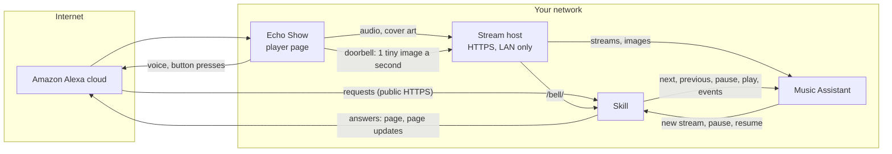
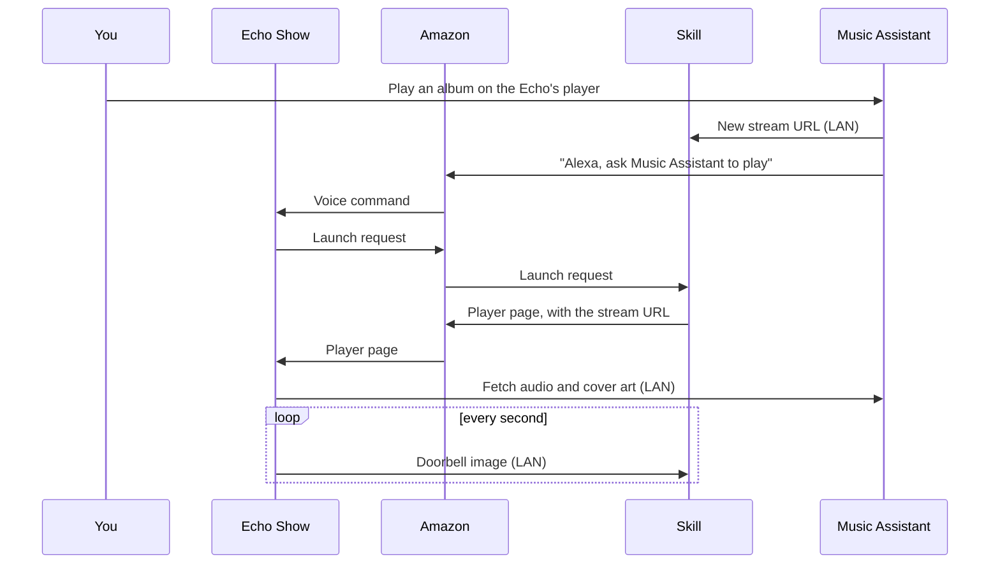

# How it works

On an Echo with a screen, the music never leaves your network. Amazon only carries the requests: what you say, the skill's answer, and the player page's button presses. The Echo fetches the audio, the cover art and the page's updates from your LAN.

Only the skill endpoint has to be public. Music Assistant stays local.

## Who talks to whom

- **Public:** only the skill endpoint (`SKILL_HOSTNAME`). Amazon calls it for every request.
- **LAN only:** the stream host (`MA_HOSTNAME`), MA's API (`MA_API_URL`), and the doorbell (`APL_BELL_URL`).
- The stream host needs a name with a trusted HTTPS certificate. Its DNS record can exist only on your LAN.

## Playing music

After this first start, MA hands the open page its next track, seek, pause and resume directly. The page stays open and nothing is spoken.

## The player page

The page shows the cover, title, artist, album, time, and the file's quality. Its buttons are play/pause, previous, next, shuffle, repeat, favourite, and up next. Tapping the cover opens the album.

Every button goes to MA, so MA's queue stays the source of truth. A press travels two ways at once: through Amazon, and over the LAN in the doorbell URL. The first copy to arrive wins, so the LAN copy usually acts about a second sooner.

## The doorbell

Without the doorbell, the page asks the skill for news through Amazon. Each answer schedules the next question, so one lost request freezes the screen.

With `APL_BELL_URL` set, the page reloads a tiny image from the skill once a second, over the LAN. The skill answers with the image while nothing changed. It answers with a 404 when there is news. The page then pulls the news through Amazon. A lost pull only delays the news, because the bell keeps failing until the page has it.

The bell also lets the skill notice when the page closes or its stream stalls. In both cases it pauses MA, so MA doesn't show a silent Echo as playing.

## Voice commands

"Alexa, ask Music Assistant to play the album …", "shuffle artist …", "queue song … next", "move the music to the kitchen", "stop in 30 minutes". See [Voice commands](README.md#voice-commands).

The skill reads your artist, album, playlist and player names from MA once a day and uploads them to the skill's voice model at Amazon. Alexa needs them to understand the names.

## What Amazon sees

- What you say to the skill, and the skill's answers.
- The page's button presses, and its pulls for news.
- Your library and player names, in the voice model.
- The stream and image URLs, but not the audio. It can't fetch them, because they resolve only on your LAN.

## Echos without a screen

An Echo without a screen plays through Alexa's AudioPlayer. Amazon checks that stream URL from the cloud, so it must be reachable from the internet over HTTPS. The LAN-only setup above doesn't work for these Echos. See [LIMITATIONS.md](LIMITATIONS.md).

## Requirements for the LAN-only setup

- An Echo with a screen, and `ENABLE_APL=true`.
- Each MA player's output codec set to MP3 or WAV. The Echo drops FLAC without a sound.
- A reverse proxy for the stream host. It sends `/bell/` to the skill and everything else to MA's stream port (8097).
- The Echo paired with its MA player. A new Echo pairs itself the first time MA plays on it. The `/devices` page pairs one by hand.
