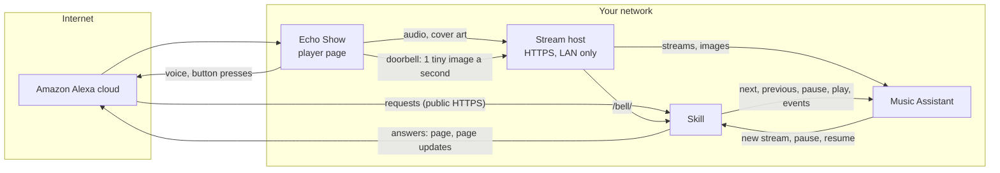
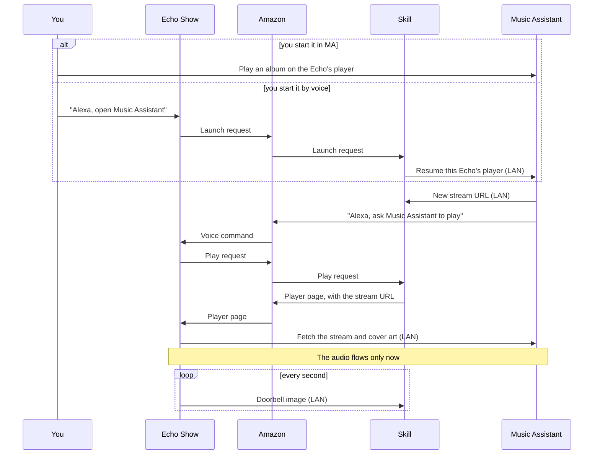
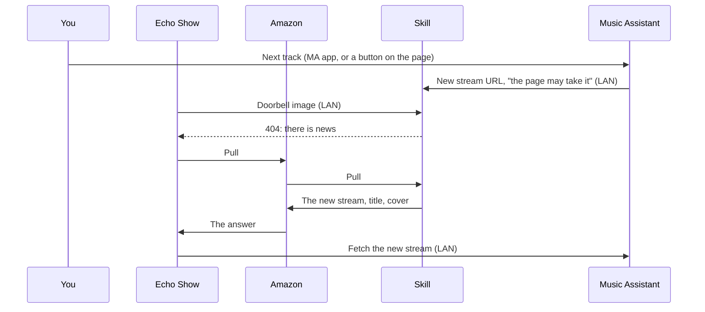

# How it works

On an Echo with a screen, the music never leaves your network. Amazon only carries the requests: what you say, the skill's answer, and the player page's button presses. The Echo fetches the audio, the cover art and the page's updates from your LAN.

Only the skill endpoint has to be public. Music Assistant stays local.

## Who talks to whom

- **Public:** only the skill endpoint (`SKILL_HOSTNAME`). Amazon calls it for every request.
- **LAN only:** the stream host (`MA_HOSTNAME`), MA's API (`MA_API_URL`), and the doorbell (`APL_BELL_URL`).
- The stream host needs a name with a trusted HTTPS certificate. Its DNS record can exist only on your LAN.

## Starting the music

An Echo plays nothing until the skill is open on it. Alexa only accepts audio as the answer to a request. So every start goes the same way: something makes the Echo open the skill, and the skill answers with the player page. The page then fetches MA's stream itself, and only then does the audio flow.

There are two ways in. MA can start it, when you play something on the Echo's player in MA. Or you can, when you say "Alexa, open Music Assistant". In the second case the skill asks MA to resume, and MA starts it the first way.

A new Echo pairs itself here. The first unpaired Echo that opens the skill within 10 seconds of MA's stream becomes that MA player's Echo.

## One stream, many tracks

MA sends the page one long stream: the whole queue, track after track. So a track change needs no new page and no new request. The video simply plays on.

The video doesn't know where one track ends. The skill works that out. When a track starts, it asks MA once for the track's length and sends the page the offset where the track begins in the stream. The page then counts the time on its own. MA gives lengths in whole seconds, so the count can drift. When the page is more than 2 seconds off MA's clock, it resyncs.

The page also knows the next track: its title and cover. At the end of a track, it switches to the next one by itself, without asking anyone. When the next track changes in MA ("play next", shuffle, a rearranged queue), the skill hears it from MA's events. It rings the doorbell, and the page fetches its new next track.

## When the page is open

While a page is open, MA doesn't need to make the Echo speak again. For next, previous, a jump in the queue, seek, pause and resume, MA tells the skill and leaves the rest to it. The skill hands the change to the page, and the page stays open.

If the page doesn't take the change within 6 seconds, the skill asks MA to send it the spoken way, and a new page opens.

## The player page

The page shows the cover, title, artist, album, time, and the file's quality. Its buttons are play/pause, previous, next, shuffle, repeat, favourite, and up next. Tapping the cover opens the album.

Every button goes to MA, so MA's queue stays the source of truth. A press travels two ways at once: through Amazon, and over the LAN in the doorbell URL. The first copy to arrive wins, so the LAN copy usually acts about a second sooner.

## The doorbell

Without the doorbell, the page asks the skill for news through Amazon. Each answer schedules the next question, so one lost request freezes the screen.

With `APL_BELL_URL` set, the page reloads a tiny image from the skill once a second, over the LAN. The image's URL carries the page's position, whether it plays, and its last button press. The skill answers with the image while nothing changed. It answers with a 404 when there is news. The page then pulls the news through Amazon. A lost pull only delays the news, because the bell keeps failing until the page has it.

## Staying in sync

The Echo and MA can disagree: a page closes, a stream stalls, Alexa breaks off. The skill watches for that and repairs it. Its corrections never start music that MA isn't playing.

| What goes wrong | How the skill notices | What it does |
|---|---|---|
| A new page shows but never plays | No event from it within 10 s. With the doorbell: no bell that says it plays within 20 s | Asks MA to resend the stream |
| Alexa closes the page on its own ("set volume to 2") | Alexa ends the session with its own error | Asks MA to resend the stream, so the page comes back |
| The page and MA disagree on playing | The bell's state differs from MA for 2 checks, 5 s apart | Pauses the one that plays |
| The stream stalls | The page says it plays, but its position stays put for 20 s | Pauses MA |
| The page closed | No bell and no pull for 30 s | Pauses MA, without speech |
| MA ended its stream early (it does at a sample-rate change) | The page plays 20 s past the track's end | Asks MA for the next track |

For a player with more than one Echo, a stalled or closed page doesn't pause MA, and the skill doesn't skip or reopen: another Echo may still play it.

## Voice commands

"Alexa, ask Music Assistant to play the album …", "shuffle artist …", "queue song … next", "move the music to the kitchen", "stop in 30 minutes". See [Voice commands](README.md#voice-commands).

The skill reads your artist, album, playlist and player names from MA once a day and uploads them to the skill's voice model at Amazon. Alexa needs them to understand the names.

## What Amazon sees

- What you say to the skill, and the skill's answers.
- The page's button presses, and its pulls for news.
- Your library and player names, in the voice model.
- The stream and image URLs, but not the audio. It can't fetch them, because they resolve only on your LAN.

## Echos without a screen

An Echo without a screen plays through Alexa's AudioPlayer. Amazon checks that stream URL from the cloud, so it must be reachable from the internet over HTTPS. The LAN-only setup above doesn't work for these Echos. See [LIMITATIONS.md](LIMITATIONS.md).

## Requirements for the LAN-only setup

- An Echo with a screen, and `ENABLE_APL=true`.
- Each MA player's output codec set to MP3 or WAV. The Echo drops FLAC without a sound.
- A reverse proxy for the stream host. It sends `/bell/` to the skill and everything else to MA's stream port (8097).
- The Echo paired with its MA player. A new Echo pairs itself the first time MA plays on it. The `/devices` page pairs one by hand.
